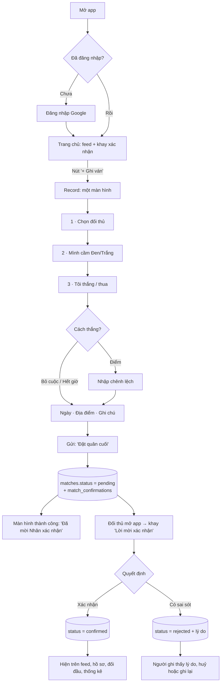
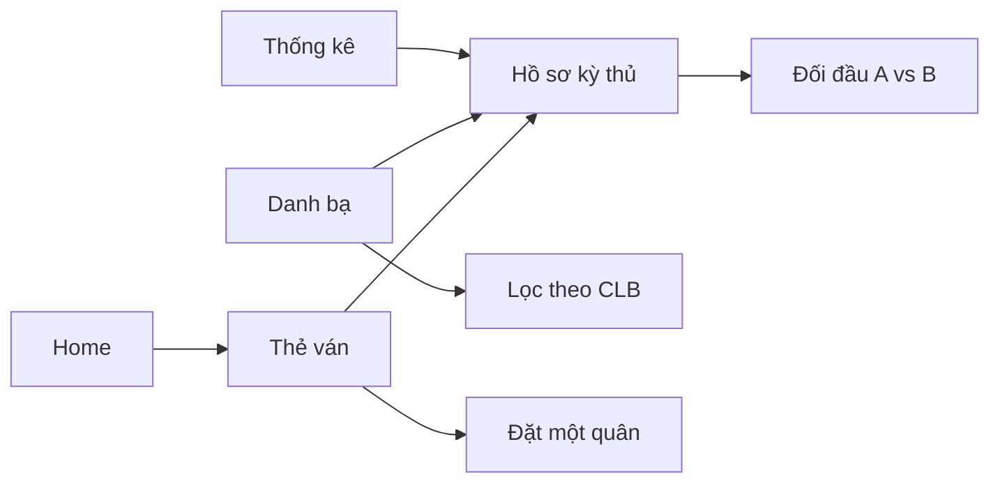
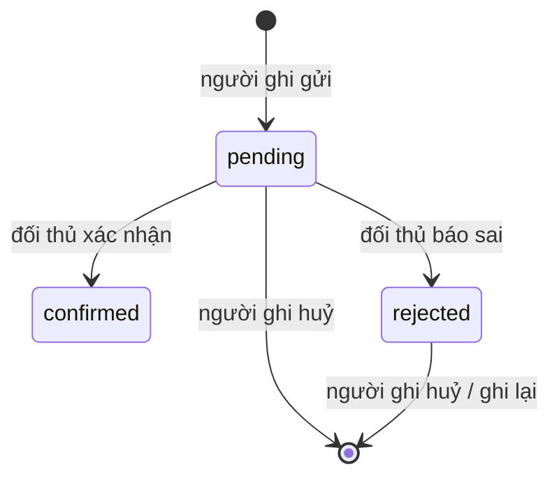

# Go Đà Nẵng — Design Brief

> *Kỳ quán số của những người chơi cờ Vây Đà Nẵng.*
> Không phải một hệ thống quản lý. Là một quán trà có bàn cờ — nơi mọi ván đấu ngoài đời được ghi nhớ.

Strava cho cờ Vây: ta không chơi online, ta **ghi lại những ván đã đánh thật** — tại CLB, quán cà phê, nhà bạn bè — và để cộng đồng cùng nhìn lại.

---

## 1. Functional Requirements

### 1.1 Nguyên tắc sản phẩm

| # | Nguyên tắc | Hệ quả thiết kế |
|---|-----------|-----------------|
| P1 | Ghi ván < 30 giây | Một màn hình duy nhất, mặc định thông minh (hôm nay, địa điểm gần nhất, đối thủ gần đây), không wizard |
| P2 | Niềm tin đến từ hai phía | Ván chỉ được tính vào thống kê khi **đối thủ xác nhận** |
| P3 | Cộng đồng trước, số liệu sau | Feed kể chuyện ("Hiền thắng Nhân 3.5 điểm tại Trà quán Hải Châu"), số liệu là gia vị |
| P4 | Mobile trước | Thao tác bằng một tay, vùng chạm ≥ 44px, bottom navigation |
| P5 | Ấm, tĩnh, không ồn ào | Không badge đỏ, không gamification quá đà; "kudos" là *đặt một quân* |

### 1.2 Yêu cầu chức năng

**F1 · Đăng nhập Google**
- F1.1 Đăng nhập bằng Google qua Supabase Auth (OAuth).
- F1.2 Lần đầu đăng nhập: nếu email trùng một hồ sơ kỳ thủ đã được tạo sẵn (admin) → *nhận hồ sơ* đó; ngược lại tạo hồ sơ mới.
- F1.3 Người chưa đăng nhập vẫn xem được feed, kỳ thủ, thống kê (công khai); các hành động ghi/xác nhận/đặt quân cần đăng nhập.
- F1.4 Chưa cấu hình Supabase thì app hiện màn hình "Kỳ quán chưa mở cửa" (không có chế độ demo, không có dữ liệu mẫu).

**F2 · Danh bạ kỳ thủ (Player Directory)**
- F2.1 Lưới thẻ kỳ thủ: avatar quân cờ, tên, hạng (kyu/dan), CLB, thành tích.
- F2.2 Tìm theo tên; lọc theo CLB, nhóm hạng (Dan / Kyu cao / Kyu thấp); sắp xếp theo hạng, số ván, tỉ lệ thắng, hoạt động gần đây.
- F2.3 Thẻ CLB hoạt động như bộ lọc (tên, lịch sinh hoạt, địa chỉ, số thành viên).

**F3 · Ghi ván (Record Match)**
- F3.1 Chọn đối thủ: thành viên được gợi ý theo tên (đối thủ gần đây + tìm kiếm). Đối thủ chưa dùng app: gõ tên tự do → tạo **hồ sơ khách**; ván với khách được ghi ngay, gắn nhãn "Ghi một phía" và không tính vào Bảng vàng.
- F3.2 Chọn màu mình cầm (Đen/Trắng) và kết quả (Tôi thắng / Tôi thua).
- F3.3 Cách thắng: **Điểm** / **Đối phương bỏ cuộc** / **Hết giờ**. Nếu Điểm → nhập chênh lệch (bội số 0.5, > 0). Bỏ cuộc/Hết giờ → không có chênh lệch.
- F3.4 Ngày (mặc định hôm nay, không cho tương lai), địa điểm (chọn CLB hoặc gõ tự do; nhớ lần cuối), ghi chú (≤ 280 ký tự).
- F3.5 Tuỳ chọn nâng cao (thu gọn): kích thước bàn (9/13/19), chấp (0–9 quân).
- F3.6 Gửi → tạo ván `pending` + một yêu cầu xác nhận cho đối thủ.
- F3.7 Người ghi có thể huỷ ván khi còn `pending` hoặc `rejected`.

**F4 · Xác nhận ván (Match Confirmation)**
- F4.1 Đối thủ thấy "Lời mời xác nhận" ở trang chủ (khay riêng) và trong trang ván.
- F4.2 Hai hành động: **Xác nhận** → `confirmed`; **Có sai sót** (kèm lý do tuỳ chọn) → `rejected`.
- F4.3 Chỉ ván `confirmed` xuất hiện trong feed công khai, hồ sơ, đối đầu, thống kê.
- F4.4 Người ghi thấy trạng thái ván mình gửi ("Đang chờ Nhân xác nhận").
- F4.5 Không ai tự xác nhận ván của chính mình; mỗi yêu cầu chỉ trả lời một lần.

**F5 · Community Feed**
- F5.1 Dòng "kỳ phổ" các ván đã xác nhận, mới nhất trước, tải thêm theo trang.
- F5.2 Thẻ ván: hai avatar quân cờ đối diện, người thắng được nhấn nhẹ, câu kể chuyện, địa điểm, ngày, ghi chú.
- F5.3 Tab lọc: Tất cả · CLB của tôi · Ván của tôi.
- F5.4 *Đặt một quân* (kudos): mỗi người một lần mỗi ván, có thể thu hồi.
- F5.5 Điểm nhấn: "Lật kèo" (thắng người hạng cao hơn), "Thắng đậm" (chênh ≥ 20 điểm).

**F6 · Hồ sơ kỳ thủ (Player Profile)**
- F6.1 Đầu trang: avatar quân cờ lớn, tên, hạng, CLB, "chơi cờ từ năm", giới thiệu.
- F6.2 Số liệu: số ván, tỉ lệ thắng, chuỗi hiện tại, chênh lệch điểm trung bình.
- F6.3 **Form** 10 ván gần nhất bằng quân cờ nhỏ (Thắng/Thua, có chữ — không chỉ dựa vào màu).
- F6.4 **Bàn cờ hoạt động**: 361 ngày gần nhất xếp trên lưới 19×19 — mỗi giao điểm là một ngày, có quân nếu hôm đó có ván.
- F6.5 Phân tích: khi cầm Đen vs Trắng, theo cách thắng, địa điểm hay chơi.
- F6.6 Đối thủ thường gặp → liên kết sang Đối đầu.
- F6.7 Lịch sử ván. Chủ hồ sơ: sửa thông tin (tên, hạng, CLB, giới thiệu, năm bắt đầu).

**F9 · Kỳ phổ SGF**
- F9.1 Hai người chơi của ván tải file `.sgf` (lúc ghi ván hoặc sau đó), thay hoặc gỡ; người khác không được.
- F9.2 Kỳ phổ công khai cùng ván; trang chi tiết có bàn cờ tái hiện: lùi/tiến từng nước, thanh trượt, phím mũi tên, tự chạy, số quân bắt, lời bình.
- F9.3 Kiểm tra khi tải lên: đúng SGF, bàn 9/13/19 và trùng kích thước ván, có nước đi, không đi vào điểm đã có quân, tối đa 200 KB.

**F7 · Đối đầu (Head-to-Head)**
- F7.1 Chọn hai kỳ thủ (URL chia sẻ được: `?a=&b=`).
- F7.2 Tỉ số tổng, thanh giằng co bằng quân cờ, chuỗi hiện tại, chênh lệch điểm trung bình, kết quả theo màu quân.
- F7.3 Dòng thời gian các ván giữa hai người.
- F7.4 Câu tóm tắt tự động ("Hiền dẫn 6–4, Nhân thắng 2 ván gần nhất").

**F8 · Thống kê cộng đồng**
- F8.1 Tổng quan: kỳ thủ, ván, CLB, ván tuần này.
- F8.2 Nhịp độ: số ván theo tuần (cột xếp bằng quân cờ).
- F8.3 Cách thắng (điểm/bỏ cuộc/hết giờ), tỉ lệ thắng Đen vs Trắng, chênh lệch trung bình.
- F8.4 Bảng xếp: chăm chỉ nhất, tỉ lệ thắng cao nhất (≥ 5 ván), chuỗi thắng dài nhất, lật kèo đáng nhớ.
- F8.5 Phân bố hạng; CLB & địa điểm sôi động nhất.
- F8.6 Bộ lọc thời gian: 30 ngày · 90 ngày · Tất cả.

### 1.3 Phi chức năng
- **Hiệu năng**: trang đọc dựng ở server (RSC), LCP < 2.5s trên 4G; hình ảnh hầu như là SVG/CSS.
- **Bảo mật**: RLS trên mọi bảng; email không bao giờ lộ công khai (column-level grant); validate bằng zod ở API.
- **Truy cập**: tương phản AA trên cả sáng/tối, trạng thái không chỉ bằng màu, `prefers-reduced-motion` tắt animation quân cờ.
- **I18n**: giao diện tiếng Việt; thuật ngữ cờ Vây chuẩn (Đen/Trắng, chấp, hết giờ, bỏ cuộc).
- **Dark mode**: "Trà quán ban đêm" — nâu than + quân cờ ấm.

### 1.4 Ngoài phạm vi MVP
Xếp hạng Elo tự động, giải đấu, tải SGF, thông báo push/email, phân quyền admin UI, tự động xác nhận sau N ngày (xem README → Roadmap).

---

## 2. User Flow

### 2.1 Luồng chính: ghi ván → xác nhận → lên feed



### 2.2 Khám phá



### 2.3 Trạng thái ván



---

## 3. ERD

```mermaid
erDiagram
  CLUBS ||--o{ USERS : "thành viên"
  CLUBS ||--o{ MATCHES : "tổ chức tại"
  USERS ||--o{ MATCHES : "black_player"
  USERS ||--o{ MATCHES : "white_player"
  USERS ||--o{ MATCHES : "recorded_by"
  MATCHES ||--|| MATCH_CONFIRMATIONS : "cần xác nhận"
  USERS ||--o{ MATCH_CONFIRMATIONS : "người xác nhận"
  MATCHES ||--o{ KUDOS : "nhận"
  USERS ||--o{ KUDOS : "đặt quân"

  CLUBS {
    uuid id PK
    text slug UK
    text name
    text description
    text address
    text meets_at
    timestamptz created_at
  }
  USERS {
    uuid id PK
    uuid auth_id UK "→ auth.users, null = chưa nhận hồ sơ"
    text email UK "riêng tư"
    text display_name
    smallint rank_value "1d=1, 1k=0, 2k=-1 …"
    uuid club_id FK
    text bio
    smallint playing_since
    boolean is_guest "khách: người chưa dùng app"
    uuid created_by FK "người tạo khách"
    timestamptz created_at
  }
  MATCHES {
    uuid id PK
    uuid black_player FK
    uuid white_player FK
    uuid winner FK
    win_method win_method "points | resign | time"
    numeric score_difference "chỉ khi points"
    date played_on
    text location
    uuid club_id FK "tuỳ chọn"
    text note
    smallint board_size "9 | 13 | 19"
    smallint handicap "0..9"
    match_status status "pending | confirmed | rejected"
    uuid recorded_by FK
    timestamptz created_at
    timestamptz resolved_at
  }
  MATCH_CONFIRMATIONS {
    uuid id PK
    uuid match_id FK_UK
    uuid user_id FK "đối thủ"
    match_status status
    text reason
    timestamptz responded_at
    timestamptz created_at
  }
  KUDOS {
    uuid match_id PK_FK
    uuid user_id PK_FK
    timestamptz created_at
  }
```

> `kudos` là bảng bổ sung ngoài 4 bảng gốc, phục vụ "đặt một quân". Có thể bỏ mà không ảnh hưởng phần còn lại.

**Ràng buộc quan trọng**: `black_player <> white_player`; `winner ∈ {black, white}`; `recorded_by ∈ {black, white}`; `score_difference` bắt buộc & > 0 & bội 0.5 khi `win_method = points`, và `NULL` với các cách khác; `played_on <= today`.

---

## 4. Folder Structure

```
.
├── archive/co-vay-blog-v1/        # blog cũ (đã lưu trữ)
├── docs/DESIGN.md                 # tài liệu này
├── supabase/
│   ├── config.toml
│   ├── migrations/
│   │   └── 20260101000000_init.sql   # enum, bảng, index, trigger, RLS
└── src/
    ├── middleware.ts                  # làm mới session Supabase (bỏ qua khi chưa cấu hình)
    ├── types/database.ts              # kiểu Supabase (định dạng `supabase gen types`)
    ├── app/
    │   ├── layout.tsx · globals.css · loading.tsx · not-found.tsx
    │   ├── (site)/
    │   │   ├── layout.tsx             # header + bottom nav + nền bàn cờ
    │   │   ├── page.tsx               # Home: feed + stats + khay xác nhận
    │   │   ├── record/page.tsx
    │   │   ├── players/page.tsx
    │   │   ├── players/[id]/page.tsx  # Profile
    │   │   ├── head-to-head/page.tsx
    │   │   ├── stats/page.tsx
    │   │   ├── matches/[id]/page.tsx
    │   │   └── login/page.tsx
    │   ├── auth/callback/route.ts · auth/signout/route.ts
    │   └── api/
    │       ├── players/route.ts · players/[id]/route.ts      # GET, POST (tạo khách), PATCH
    │       ├── matches/route.ts · matches/[id]/route.ts
    │       ├── matches/[id]/confirm/route.ts
    │       ├── matches/[id]/kudos/route.ts
    │       └── head-to-head/route.ts · stats/route.ts
    ├── components/
    │   ├── ui/                         # shadcn/ui (button, card, input, tabs, dialog, sheet, select, textarea, badge, skeleton, sonner…)
    │   ├── go/                         # ngôn ngữ thị giác: Stone, StoneAvatar, StoneLoader, BoardBackdrop, WoodCard, ActivityBoard, FormStones, StoneStack…
    │   ├── layout/                     # SiteHeader, BottomNav, ThemeToggle, UserMenu
    │   ├── feed/                       # MatchCard, FeedList, KudosButton, FeedTabs
    │   ├── match/                      # RecordMatchForm, OpponentPicker, ScoreStepper, ConfirmationTray, ConfirmationActions
    │   ├── players/                    # PlayerCard, PlayerFilters, ClubCard, ProfileEditSheet
    │   └── stats/                      # Leaderboard, WeeklyStones, MethodBar, RankDistribution, RangeTabs
    └── lib/
        ├── supabase/ (client · server · middleware)
        ├── data/ (types · index · supabase)          # repository
        ├── auth.ts · stats.ts · rank.ts · format.ts · validators.ts · utils.ts
```

**Quyết định kiến trúc**
- **Repository pattern**: `lib/data` có một interface (`Repository`) với hiện thực Supabase; trang & API chỉ biết interface.
- **Thống kê tính ở một nơi** (`lib/stats.ts`, hàm thuần) → test được, dùng chung cho profile / H2H / stats / API.
- **Đọc bằng RSC, ghi bằng Route Handlers** (zod validate) + `router.refresh()`.

---

## 5. Wireframes

### 5.1 Mobile — Home

```
┌──────────────────────────────┐
│ 碁  Go Đà Nẵng        ☾  (●) │  header
├──────────────────────────────┤
│ Chào Hiền,                   │
│ hôm nay chưa có ván nào.     │
│ [  ○  Ghi ván mới  ]         │  hero, nền lưới bàn cờ
│  42 kỳ thủ · 187 ván · 5 CLB │
├──────────────────────────────┤
│ ╔ Lời mời xác nhận (1) ═════╗ │  chỉ hiện khi có
│ ║ (●) Nhân vs (○) Bạn       ║ │
│ ║ Bạn thắng 3.5 · Hải Châu  ║ │
│ ║ [Xác nhận] [Có sai sót]   ║ │
│ ╚═══════════════════════════╝ │
├──────────────────────────────┤
│ Kỳ phổ  [Tất cả|CLB|Của tôi] │
│ ┌──────────────────────────┐ │
│ │ (●)━━ vs ━━(○)           │ │
│ │ Minh thắng Lan · 3.5 đ   │ │  MatchCard
│ │ Trà quán Hải Châu · Hôm qua│ │
│ │ "Ván giằng co ở góc…"    │ │
│ │ ◦ Đặt một quân (4)       │ │
│ └──────────────────────────┘ │
│ …                            │
├──────────────────────────────┤
│ 🏠   👥   (＋)   ⚔   📊      │  bottom nav, ＋ = quân cờ lớn
└──────────────────────────────┘
```

### 5.2 Desktop — Home

```
┌───────────────────────────────────────────────────────────────┐
│ 碁 Go Đà Nẵng   Trang chủ  Kỳ thủ  Đối đầu  Thống kê   ☾ (●)  │
├───────────────────────────────────────┬───────────────────────┤
│ Hero (lưới bàn cờ)                    │ Tuần này              │
│ Khay xác nhận                         │  12 ván · 3 lật kèo   │
│ Kỳ phổ cộng đồng (feed)               │ Bảng xếp chuỗi thắng  │
│  ┌ MatchCard ┐                        │ Câu lạc bộ            │
│  └───────────┘                        │ [Ghi ván mới]         │
└───────────────────────────────────────┴───────────────────────┘
```

### 5.3 Mobile — Record Match (≤ 30 giây)

```
┌──────────────────────────────┐
│ ←  Ghi ván                   │
├──────────────────────────────┤
│ Đối thủ                      │
│ (●)Minh (○)Lan (●)Tuấn  ⌕    │  gần đây — chạm 1 lần
│                              │
│ Bạn cầm quân                 │
│   (●) Đen     (○) Trắng      │  hai quân lớn
│                              │
│ Kết quả                      │
│  [ Tôi thắng ] [ Tôi thua ]  │
│                              │
│ Thắng bằng                   │
│  [Điểm] [Bỏ cuộc] [Hết giờ]  │
│  ─  3.5  +   0.5 2.5 5.5 …   │  chỉ khi 'Điểm'
│                              │
│ 📅 Hôm nay   📍 Trà quán HC  │
│ ▸ Thêm ghi chú · bàn · chấp  │
│                              │
│ [   Đặt quân cuối — Gửi   ]  │  dính đáy
└──────────────────────────────┘
```

### 5.4 Profile

```
┌──────────────────────────────┐
│     ( ● )  big stone         │
│     Nguyễn Minh · 3 kyu      │
│     CLB Sông Hàn · từ 2016   │
│  "Thích khai cuộc Trung Quốc"│
│ ┌────┬────┬────┬────┐        │
│ │ 38 │61% │ +3 │2.1 │ ván·thắng·chuỗi·chênh │
│ └────┴────┴────┴────┘        │
│ Form  T T B T T B T T T B    │
│ Bàn cờ hoạt động 19×19       │
│  · · ● · · ○ · · · …         │
│ Cầm Đen 64% │ Cầm Trắng 58%  │
│ Đối thủ thường gặp → H2H     │
│ Lịch sử ván …                │
└──────────────────────────────┘
```

### 5.5 Head-to-Head

```
┌──────────────────────────────┐
│  (●) Minh   ⚔   Lan (○)      │
│      6   —   4               │
│  ●●●●●●  │  ○○○○            │  stone tug-of-war
│  Minh dẫn 6–4; Lan thắng 2   │
│  ván gần nhất.               │
│  Cầm Đen: 3–2 │ Cầm Trắng 3–2│
│  Timeline ván …              │
└──────────────────────────────┘
```

### 5.6 Statistics

```
┌──────────────────────────────┐
│ Thống kê  [30 ngày|90|Tất cả]│
│ 187 ván · 42 kỳ thủ · 5 CLB  │
│ Ván mỗi tuần (cột = quân xếp)│
│  ○                           │
│  ○ ○     ○                   │
│  ○ ○ ○ ○ ○ …                 │
│ Cách thắng ▓▓▓▓▓░░░ ▒▒       │
│ Đen 49% · Trắng 51%          │
│ Bảng xếp: Chăm chỉ · Tỉ lệ ·  │
│           Chuỗi · Lật kèo     │
└──────────────────────────────┘
```

---

## 6. Ngôn ngữ thị giác

| Yếu tố | Cách làm |
|--------|----------|
| Nền | Giấy washi `#F5E7C6` + lưới bàn cờ mờ (đường kẻ + hoshi) bằng CSS gradient |
| Thẻ | "Gỗ": `#E5D0A8 → #D8BC87`, vân gỗ bằng SVG noise, viền trong như mép bàn cờ |
| Avatar | Quân cờ SVG (Đen `#111` / Trắng `#F8F8F8`), bóng sáng gradient, chữ cái khắc; màu quân ổn định theo tên |
| Loading | `StoneLoader`: quân Đen/Trắng lần lượt rơi xuống giao điểm ("tách!") |
| Chữ | Cormorant Garamond (tiêu đề) + Be Vietnam Pro (nội dung); số dùng tabular |
| Wabi-sabi | Bất đối xứng nhẹ, độ nghiêng vài độ cho quân, khoảng trắng rộng, không viền cứng |
| Dark | Nền `#2A2118`, thẻ gỗ tối, chữ `#F5E7C6`, accent `#D8BC87` |
| Motion | 160–320ms, ease-out; tắt khi `prefers-reduced-motion` |
